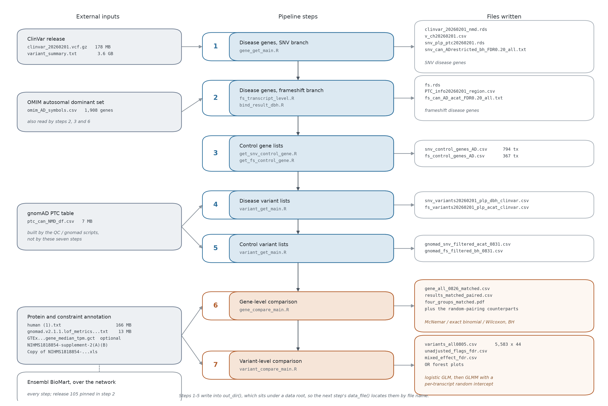

# NMDesc: NMD-escape disease genes

Annotates premature termination codon (PTC) variants from ClinVar, classifies them by
whether they escape nonsense-mediated decay (NMD) under canonical exon-junction-complex
rules, and compares gene-, variant- and protein-level features of NMD-escape disease genes
against length-matched controls.

## Directory layout

```text
.
├── data/
│   ├── ship/                       all pipeline inputs, located by file name
│   ├── MANIFEST.md                 what each input is and where it came from
│   ├── ship_inventory.csv          one row per shipped file with its size
│   └── classification.csv          every referenced file name, classified
├── figures/
│   ├── manuscript/                 the manuscript figures and the scripts behind them
│   ├── dataflow.{pdf,png}          pipeline data-flow diagram
│   ├── result_gene_level_matched.{pdf,png}
│   └── result_variant_mixed_effect.{pdf,png}
├── gene level_v5/
│   ├── control genes/{snv,frameshift}/
│   ├── disease genes/{snv,framesift}/
│   ├── features/functions/         helpers sourced by gene_get_main.R
│   ├── synonymous variants/
│   ├── lib/{paths.R,get_statistics.R}
│   ├── gene_get_main.R             entry point, step 1
│   └── gene_compare_main.R         entry point, step 6
├── variant level_v5/
│   ├── clinvar/{snv,frameshift}/
│   ├── gnomad/
│   ├── new_create_fasta_functions.R
│   ├── variant_get_main.R          entry point, steps 4 and 5
│   └── variant_compare_main.R      entry point, step 7
├── plotting/
│   ├── as_run_1to1/                gene-level manuscript figures
│   ├── variant_level/              variant-level manuscript figures
│   ├── house_patches/
│   └── {R,python}/                 upstream plotting scripts
├── nmdesc_colab/                   browser runner for the seven steps
├── lib/                            copy of gene level_v5/lib, for relative lookups
└── run_analysis.R                  entry point for the whole chain
```

## Installation

R >= 4.2, from <https://www.r-project.org/>.

```r
install.packages(c("tidyverse", "data.table", "stringr", "jsonlite", "readr",
                   "ggplot2", "scales", "ggpubr", "patchwork", "lme4", "lmerTest",
                   "broom", "broom.mixed", "readxl", "DiscreteFDR", "remotes",
                   "BiocManager"))
BiocManager::install(c("biomaRt", "GenomicRanges", "IRanges", "S4Vectors", "Biostrings",
                       "AnnotationDbi", "GenomicFeatures", "VariantAnnotation", "STRINGdb"))
remotes::install_github(c("kostkalab/aenmd.data.ensdb.v105", "kostkalab/aenmd"))
```

Optional external tools: VEP for variant annotation, AlphaFold2 for structural features,
metapredict for disorder prediction, CIDER and ParSe for sequence properties. Their output
is read back in by the scripts that consume it.

## Quick start

```bash
Rscript run_analysis.R --dry-run    # preflight every step, run nothing
Rscript run_analysis.R              # all seven steps, in order
Rscript run_analysis.R 6 7          # a subset
```

| Step | Script | Output |
|---|---|---|
| 1 | `gene level_v5/gene_get_main.R` | SNV NMD-escape disease genes |
| 2 | `disease genes/framesift/fs_transcript_level.R`, `bind_result_dbh.R` | frameshift disease genes (per-transcript ACAT / BH) |
| 3 | `control genes/snv/get_snv_control_gene.R`, `control genes/frameshift/get_fs_control_gene.R` | SNV + FS control gene lists |
| 4 | `variant level_v5/variant_get_main.R` | ClinVar P/LP disease variant lists |
| 5 | `variant level_v5/variant_get_main.R` (control inputs switched on) | gnomAD control variant lists |
| 6 | `gene level_v5/gene_compare_main.R` | gene-level comparison, CDS-matched pairs |
| 7 | `variant level_v5/variant_compare_main.R` | variant-level comparison, GLM / GLMM / Bayesian |

`--dry-run` reports, step by step, missing R packages, missing input files and missing
session objects. A step whose declared outputs already exist is marked `cached` and later
steps continue from those files; a step with unmet inputs is marked `blocked` and the chain
continues.

Steps 1-5 write into `out_dir()`, which sits under the data root, so `data_file()` in the
next step finds them by name. That is the only interface between steps.

Two inputs are not shipped and have to be fetched before step 1: the ClinVar VCF
`clinvar_20260201.vcf.gz` and `variant_summary.txt`. `data/MANIFEST.md` has the URLs. Every
step also reaches Ensembl BioMart over the network; step 2 pins release 105.

## How paths are resolved

Everything goes through `gene level_v5/lib/paths.R`:

- One data root, `data/` inside the repository, found by walking up from `paths.R` to the
  directory holding `gene level_v5`. `NMDESC_DATA` overrides it.
- `data_file("name.csv")` looks inputs up by **file name** at any depth under the root;
  subdirectory layout does not matter.
- `out_file()` / `out_dir()` write to `NMDESC_OUT`, default `<data root>/output`.
- The first run indexes the data root once and caches it as `.nmdesc_path_index.rds`; a
  lookup miss forces a rescan.

```bash
export NMDESC_DATA=/path/to/data       # overrides the in-repo default
export NMDESC_OUT=/path/to/output
```

## Protein level

The protein-level analyses are run on their own, outside the seven-step chain:

```r
source("variant level_v5/new_create_fasta_functions.R")   # FASTA for IDR / AF2 input
```

| Output | Generated from | Used for |
|---|---|---|
| FASTA | `snv_variants` | IDR analysis, AlphaFold2 input |
| VCF | `snv_variants` | VEP functional annotation |

## Figures

`figures/manuscript/` holds every figure in the manuscript together with the script that
drew it; see its README for the figure-to-script table. The two results figures of the
seven-step chain are at the top of `figures/`:

| Figure | Produced by |
|---|---|
| `result_gene_level_matched.{pdf,png}` | step 6, `plot_matched_results()` in `gene_compare_main.R` |
| `result_variant_mixed_effect.{pdf,png}` | step 7, `plot_mixed_effect_flags()` in `variant_compare_main.R` |



## Statistical methods in the code

| Method | Scripts | Typical use |
|---|---|---|
| Wilcoxon | 37 | Paired and unpaired feature comparisons |
| BH / FDR | 24 | Multiple-testing correction across feature panels |
| Fisher exact | 13 | Gene- and variant-level enrichment tables |
| binomial exact | 7 | Observed vs expected NMD-escape counts |
| GLMM (lme4) | 7 | Mixed-effect models with gene or protein random intercepts |
| Bayesian GLMM (brms) | 4 | Sensitivity analysis for degenerate fits |
| McNemar | 3 | Paired categorical flag comparisons |
| chi-squared | 3 | Categorical contingency tests |
| t-test | 3 | Continuous feature comparisons |
| logistic regression | 3 | Binary outcome modelling on variant features |
| STRINGdb centrality | 3 | PPI degree centrality per gene |
| DiscreteFDR | 2 | FDR correction for discrete test statistics |
| Spearman | 2 | Rank correlation between p-value methods |
| ACAT | 1 | Aggregated Cauchy combination of per-transcript p-values |
| Tarone | 1 | Filtering structurally unreachable discrete tests |
| Kruskal-Wallis | 1 | Multi-group comparisons |
| bootstrap / resampling | 1 | Repeated sampling of one variant per protein |

If `brms` is missing, the Bayesian sensitivity analysis in step 7 is skipped and the rest
proceeds.

## Contact

Maintainer: Jiaoyang Xu (JXU), jiaoyang.xu@uth.tmc.edu
